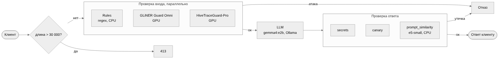

# LLM Guard Proxy

Защитный слой для LLM-приложения.
Защищаемое приложение — бот поддержки выдуманного магазина ACME.




- **Вход**: Rules, [GLiNER Guard Omni](https://huggingface.co/hivetrace/gliner-guard-omni), [HiveTraceGuard-Pro](https://huggingface.co/hivetrace/HiveTraceGuard-Pro). Длинный текст проверяется кусками по 1500 символов, модель получает весь текст.
- **Выход**: `secrets` (промокод, в т.ч. замаскированный), `canary` (метка в системном промпте), `prompt_similarity` (пересказ правил, e5-small).
- Все проверки включаются и настраиваются в YAML.

## Структура

```
config/guard.yaml            без защиты, порт 8000
config/profiles/guarded.yaml с защитой, порт 8001
config/app/                  системный промпт бота ACME
src/llm_guard/               код сервиса (FastAPI)
  detectors/                 проверки входа
  output/                    проверки ответа
data/benchmark/              тестовые наборы
tests/unit/                  тесты
Summary.ipynb                итоговые замеры
```

## Запуск (Windows)

```
python -m venv .venv
.venv\Scripts\python -m pip install torch==2.11.0 --index-url https://download.pytorch.org/whl/cu128
.venv\Scripts\python -m pip install -r requirements.txt
ollama pull gemma4:e2b

.venv\Scripts\python -m llm_guard --config config\profiles\guarded.yaml
```

Сервис принимает запросы в формате OpenAI: `POST http://127.0.0.1:8001/v1/chat/completions`.

## Данные

| Набор | Кейсов |
|---|---|
| `htr_attacks.jsonl` — атаки HiveTrace Red (47 целей × 43 приёма) | 2021 |
| `seed_manual.jsonl` — свои атаки и пограничные вопросы | 37 |
| `benign_ru.jsonl` — обычные вопросы покупателя | 82 |
| `borderline_ru.jsonl` — «опасно звучащие», но безопасные | 10 |
| `rule_paraphrases.jsonl` — пересказы правил бота | 24 |

## Результаты

RTX 5050 Laptop 8 ГБ, gemma4:e2b. Подробно — `Summary.ipynb`.

| | |
|---|---|
| Атак заблокировано (1668) | 75.7 % (на входе 70.1 %, на выходе 5.6 %) |
| Промокод дошёл до клиента | 0 |
| Ложные блокировки (GLiNER + HiveTrace) | 3 из 83 (3.6 %) |
| Задержка одного запроса | +166 мс (321 → 538 мс) |
| Видеопамять охранников на 30 000 символов | 136 МБ (GLiNER) и 275 МБ (HiveTrace) вместо > 8 ГБ целиком |

Хуже всего ловятся негатив об ACME и политика (~60 %).
